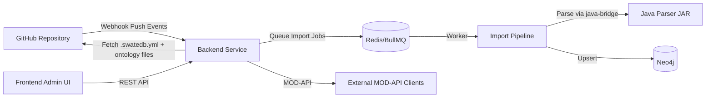

# SwateDB

SwateDB is a monorepo for an ontology-focused microservice platform backed by Neo4j.
It ingests ontology files from GitHub repositories, parses .obo/.owl data through a Java parser bridge,
and exposes MOD-API compatible endpoints for discovery and interoperability.

## Architecture



## Repository Layout

- [packages/java-parser/README.md](packages/java-parser/README.md): Java OWL/OBO parsing library.
- [packages/ontology-lib/README.md](packages/ontology-lib/README.md): TypeScript parsing and validation library.
- [packages/backend/README.md](packages/backend/README.md): Express microservice and Neo4j integration.
- [packages/frontend/README.md](packages/frontend/README.md): Admin dashboard for sync and status.
- [ci-tools/README.md](ci-tools/README.md): CLI tooling for ontology repository CI.

## Quick Start

1. Install Node.js 20.x and Java 17.
2. Install dependencies:

```bash
npm install
```

3. Run repository checks:

```bash
npm run check
```

## Docker Compose (Phase 5)

Use this path for a fresh startup with Neo4j, Redis, backend, and frontend:

```bash
npm run compose:up
```

Services:

- Frontend: http://localhost:8080
- Backend: http://localhost:3000
- Swagger docs: http://localhost:3000/doc/api/
- Neo4j browser: http://localhost:7474

To stop the stack:

```bash
npm run compose:down
```

## Development Compose (Hot Reload + Debug)

To run the base stack plus dev overrides:

```bash
npm run compose:dev:up
```

Dev overrides provide:

- Backend hot reload from mounted source.
- Frontend Vite dev server on http://localhost:5173.
- Backend debugger on port 9229.

Stop dev compose stack:

```bash
npm run compose:dev:down
```

## GitHub App Setup

1. Create a GitHub App and record App ID.
2. Generate a private key and store it in GITHUB_PRIVATE_KEY.
3. Configure webhook secret and set GITHUB_WEBHOOK_SECRET.
4. Install the GitHub App on the ontology repository.
5. Set these values in .env (copy from .env.example):
    - ADMIN_TOKEN
    - GITHUB_APP_ID
    - GITHUB_PRIVATE_KEY
    - GITHUB_WEBHOOK_SECRET
    - GITHUB_API_BASE_URL (only override for GitHub Enterprise)

Recommended webhook endpoint:

- POST /api/github/webhooks

## First Sync Flow

1. Start backend and frontend (local or compose).
2. Open the frontend admin console.
3. Enter ADMIN_TOKEN in the token prompt.
4. Trigger manual sync from Manual Sync view with:
    - owner
    - repo
    - ref (for example main)
    - installationId
5. Check Import Log for queued and completed job states.

Repository expectations:

- A repository-level .swatedb.yml controls include/exclude paths and externals.
- Ontology files are discovered from include/exclude patterns and imported to Neo4j.

## End-to-End Smoke Check

After services are up:

```bash
npm run smoke:e2e
```

The smoke script checks:

- Backend health endpoint returns 200.
- Artefacts endpoint returns a hydra collection payload.
- Frontend root URL is reachable.

Optional environment variables for smoke target overrides are listed in .env.example.

## Development Workflow

- Keep package READMEs updated as functionality evolves.
- Follow phase-gated implementation in [Plan.md](Plan.md).
- Keep API intent aligned with [Microservice.md](Microservice.md) and [openapi.yaml](openapi.yaml).

## Contributing

1. Create a feature branch.
2. Make focused changes by phase.
3. Run `npm run check` before opening a PR.
4. Fill out the PR checklist in the pull request template.

## License

MIT
