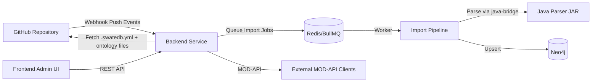

# SwateDB

SwateDB is a monorepo for an ontology-focused microservice platform backed by Neo4j.
It ingests ontology files from GitHub repositories, parses .obo/.owl data through a Java parser bridge,
and exposes MOD-API compatible endpoints for discovery and interoperability.

## Architecture



## Repository Layout

- [packages/java-parser/README.md](packages/java-parser/README.md): Java OWL/OBO parsing library.
- [packages/ontology-lib/README.md](packages/ontology-lib/README.md): TypeScript parsing and validation library.
- [packages/backend/README.md](packages/backend/README.md): Express microservice and Neo4j integration.
- [packages/frontend/README.md](packages/frontend/README.md): Admin dashboard for sync and status.
- [ci-tools/README.md](ci-tools/README.md): CLI tooling for ontology repository CI.

## Quick Start

1. Install Node.js 20.x and Java 17.
2. Install dependencies:

```bash
npm install
```

3. Run repository checks:

```bash
npm run check
```

## Development Workflow

- Keep package READMEs updated as functionality evolves.
- Follow phase-gated implementation in [Plan.md](Plan.md).
- Keep API intent aligned with [Microservice.md](Microservice.md) and [openapi.yaml](openapi.yaml).

## Contributing

1. Create a feature branch.
2. Make focused changes by phase.
3. Run `npm run check` before opening a PR.
4. Fill out the PR checklist in the pull request template.

## License

MIT
